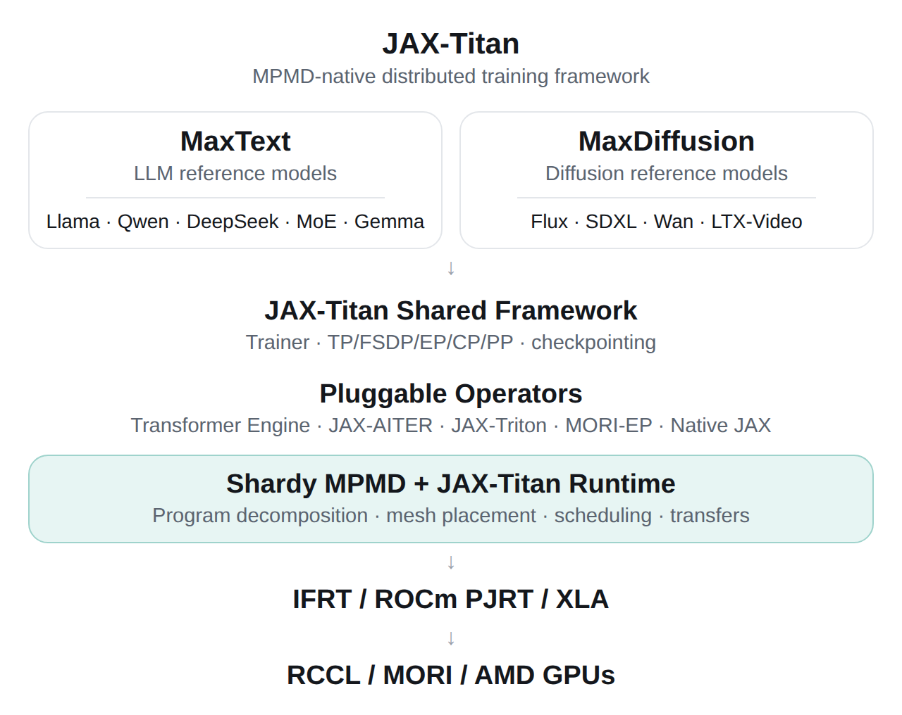

# JAX-Titan

JAX-Titan is a JAX-native MPMD training framework, built AMD-native first.

Each pipeline stage is a [Shardy MPMD](https://github.com/openxla/shardy/blob/main/rfcs/2025-06-18-mpmd-rfc.md)
named computation assigned to its own device mesh. The whole train step
compiles to one IFRT IR program: one XLA executable per stage fragment, plus
the cross-mesh transfers between them. A single controller runs it with XLA's
IFRT IR interpreter on the ROCm PJRT plugin, without Pathways.

> **Status:** early development. APIs will change.

## Architecture

<p align="center">
  
</p>

This is the target design; [What works](#what-works) lists what runs today.

## What works

- Single-controller Shardy MPMD execution on ROCm, with no Pathways service.
- Pipeline parallelism with Shardy's schedules: zero-bubble (the default),
  1F1B, GPipe and circular, with microbatching and per-stage AdamW state that
  stays on the stage's mesh.
- Inside each stage: data parallelism with gradients summed once per step,
  FSDP, tensor parallelism, and uneven layer splits.
- Orbax checkpoints of every stage's state; training resumes exactly, also
  into another layout of the same stages.
- Llama 3 models using MaxText's `llama3.1-8b` configuration, WikiText-103
  with the Llama 3 tokenizer, and throughput and MFU reporting.
- MaxText models as pipeline stages, built from MaxText 0.2.5's own layers
  (Llama 2 and 3 so far). They match MaxText's model and, with the weights
  mapped, JAX-Titan's Llama, and train with `--model=maxtext:<name>`.
- MaxDiffusion's FLUX.1 (dev and schnell) as pipeline stages of its
  double- and single-stream blocks, with its flow-matching loss, matching
  MaxDiffusion's transformer; `--model=maxdiffusion:flux-dev` trains it on
  synthetic batches.
- Checks against single-mesh `jax.jit`: every schedule and layout matches it
  in loss and parameters, over 100 steps for 1F1B.
- A baseline without the pipeline (`--parallel=dp` or `--parallel=fsdp`): the
  same model, weights and batches as one `jax.jit` program on all devices.

On 8x AMD Instinct MI355X, Llama 3.1 8B with 2 pipeline stages of 4 GPUs and
65,536 tokens per step trains at 1.45 s per step (45.1k tokens/s, 10.5% MFU)
with the zero-bubble schedule, against 1.68 s with 1F1B. Without the
pipeline, the same step as one `jax.jit` program takes 0.83 s with data
parallelism and 0.80 s with FSDP, so on one node the pipeline is still 1.7x
and 1.8x slower. [docs/pipelines.md](docs/pipelines.md) has every schedule and
layout measured, and the reasons for the gap. MaxText's Llama 3.1 8B runs the
same pipeline at 2.03 s per step, with gradients reduced per microbatch, and
FLUX.1-dev (12B) trains at 4.4 images/s at 1024x1024 on 4 stages of 2 GPUs.

```python
from jaxtitan import mpmd as jt_mpmd
from shardy.integrations.python.jax import mpmd

topology = jt_mpmd.make_topology(num_stages=2)            # mesh0, mesh1
config = jt_mpmd.make_config(topology, "ZERO_BUBBLE_H1")
train_step = jt_mpmd.make_train_step(stage_fns, optimizer)
compiled = mpmd.jit(
    train_step, config, in_shardings=..., out_shardings=...
).lower(params, opt_states, tokens, targets).compile()
```

## Requirements

JAX-Titan needs small patches to jaxlib and Shardy, kept in
[third_party/patches](third_party/patches):

- **jaxlib:** compile IFRT IR MPMD programs on PJRT-backed IFRT clients.
  Upstream jaxlib only compiles them through Pathways.
- **Shardy MPMD:** an import fix for open-source builds, and passing every
  partitioning option to the partitioner (jaxlib dropped five, including the
  one that keeps 1F1B in order).

XLA needs no patch: ROCm support in the IFRT IR atom-program passes landed as
[openxla/xla#52290](https://github.com/openxla/xla/pull/52290) (`dfca2c9`), so
build against XLA `main` at or after that commit.

The optional MaxDiffusion FLUX.1 stages need two MaxDiffusion patches, kept
there too: one imports PyTorch only to load PyTorch weights, and one fixes
FLUX.1-dev's timestep embedding at the pinned commit.

[docs/getting_started.md](docs/getting_started.md) covers the TheRock
container, the from-source JAX build and the Python environment.
[docs/amd-jax-train-runbook](docs/amd-jax-train-runbook) covers running
JAX-Titan on AMD's SPUR cluster.

## Layout

| Path | Contents |
|---|---|
| `src/jaxtitan/mpmd` | Topology, Shardy MPMD config and pipelined train steps |
| `src/jaxtitan/parallel` | DP, FSDP and TP shardings from logical parameter axes |
| `src/jaxtitan/models` | Llama 3, with parameters grouped by pipeline stage, and stages of MaxText and MaxDiffusion models (`adapters/`) |
| `src/jaxtitan/ops` | Semantic operators (native JAX today) |
| `src/jaxtitan/data` | Llama 3 tokenizer and pretokenized text sampling |
| `src/jaxtitan/trainer` | Training entry point (`python -m jaxtitan.trainer.train`) and Orbax checkpoints |
| `src/jaxtitan/observability` | Per-GPU busy and idle time from profiler traces |
| `examples/` | MPMD spike and parity checks |
| `tests/` | CPU tests: schedules and layouts against `jax.jit`, checkpoint resume, MaxText and MaxDiffusion models |
| `scripts/` | Container, build, environment, GPU-availability and post-run cleanup scripts |
| `.cursor/skills/`, `.claude/skills/` | Agent skills for Cursor and Claude Code (identical copies): coding rules, upstream debugging, and running and cleaning up training jobs |
| `third_party/patches/` | jaxlib, Shardy and MaxDiffusion patches |
| `src/jaxpp/` | JaxPP project, kept as-is for a later comparison |
| `third_party/jax-aiter/`, `third_party/jax-triton/` | JAX-AITER and JAX-Triton (git submodules), for the operator providers |

## Roadmap

- Model reference providers: MaxText for LLMs (Llama 3, Qwen3 dense and MoE,
  Mixtral, DeepSeek V4), pinned at `maxtext-v0.2.5`, and MaxDiffusion for
  diffusion models (Flux, then Wan 2.2 with its dual-expert training), pinned
  at `821afc36`. JAX-Titan takes their model definitions, configs and
  checkpoint converters, and replaces their trainers, sharding and TPU kernels
  with its own.
- Operator providers behind `jaxtitan.ops`, each checked against its native
  JAX ops, in this order: ROCm Transformer Engine, from the nightly ROCm TE
  wheels that ROCm/maxtext publishes; JAX-AITER; JAX-Triton, for Triton and
  Gluon kernels including AITER's; and JAX-FlyDSL. JAX-AITER and JAX-Triton
  are pinned as git submodules in `third_party/`. MORI-EP follows for MoE
  dispatch and combine.
- Interleaved 1F1B and DualPipeV as custom Shardy schedules, and faster
  checkpoint saves.
- Multi-node execution, and RL post-training with Ray and vLLM.

## License

MIT, see [LICENSE](LICENSE). The submodules in `third_party/` keep their own
licenses (JAX-AITER MIT, JAX-Triton Apache-2.0), and two directories keep
the Apache License 2.0:

- `src/jaxpp/`: the original JaxPP project, with its own `LICENSE` and file
  headers.
- `third_party/patches/`: patches to jax, Shardy and MaxDiffusion, which are
  Apache-2.0 projects. See [third_party/patches/README.md](third_party/patches/README.md).
